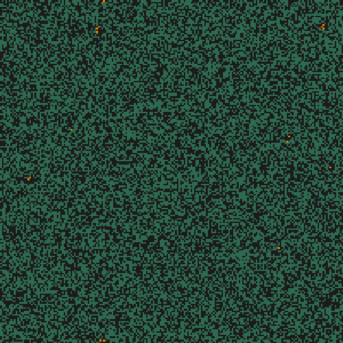
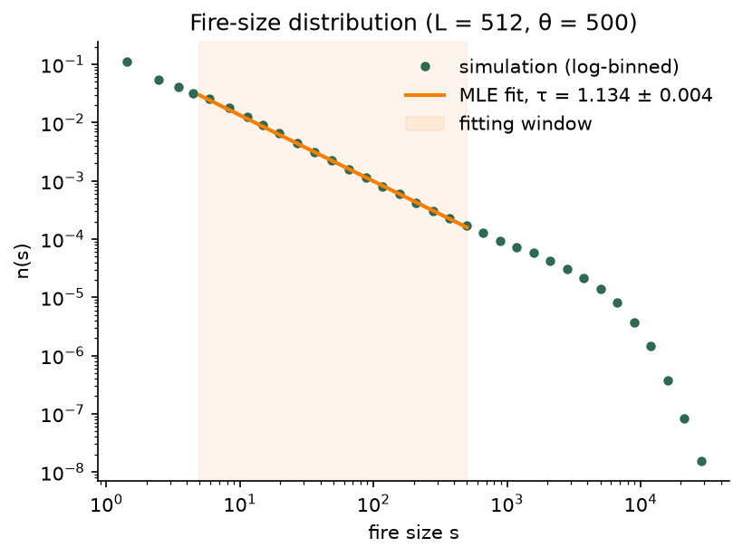
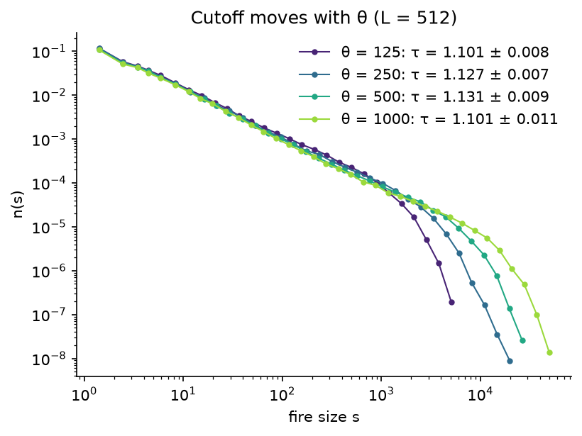

# Forest-Fire Model

[](https://github.com/mikereg/self-organised-criticality/actions/workflows/ci.yml)

[](LICENSE)

A fast, tested implementation of the [Drossel–Schwabl forest-fire model][ds92], a cellular
automaton that is a classic example of **self-organised criticality**. It measures the model's
power-law fire-size distribution with a maximum-likelihood fit.

<p align="center"></p>

## The model

Each cell of an L × L lattice is **empty**, a **tree**, or **burning**. Every time step, all
cells update simultaneously:

1. A burning cell becomes empty.
2. A tree with at least one burning neighbour starts burning.
3. A tree with no burning neighbour ignites (is struck by lightning) with probability *f*.
4. An empty cell grows a tree with probability *p*.

When fires are rare and fast compared with growth (f ≪ p ≪ 1/T_fire), the forest organises
itself into a critical state without any tuning. Fire sizes then follow a power law
n(s) ∝ s^−τ over many decades.

## Quick start

```bash
git clone https://github.com/mikereg/self-organised-criticality.git
cd self-organised-criticality
python -m venv .venv
source .venv/bin/activate
pip install -r requirements.txt        # or requirements-dev.txt for tests and the notebook
pip install --no-deps -e .
```

## Usage

```bash
# Animate stepwise mode: save a GIF, or watch it live
forest-fire animate --size 200 --p 0.01 --f 0.0001 --steps 200 --seed 4 --save fire.gif
forest-fire animate --live --neighbourhood moore --boundary fixed

# Collect fire sizes in instantaneous mode and fit the exponent
forest-fire run --size 512 --theta 500 --events 200000 --seed 0 --out fires.npz
```

Both commands take `--neighbourhood {von-neumann,moore}` (default von Neumann, as in the
literature) and `--boundary {periodic,fixed}` (default periodic). Every run is reproducible
with `--seed`.

The package can also be used as a library:

```python
import numpy as np
from forest_fire import instantaneous, powerlaw

rng = np.random.default_rng(0)
start = np.zeros((256, 256), dtype=np.int8)
result = instantaneous.simulate(start, instantaneous.Params(theta=500), n_events=50_000, rng=rng)
print(powerlaw.fit(result.fire_sizes, s_max=500))
```

## Results

The [analysis notebook](notebooks/analysis.ipynb) measures the model on a 512 × 512 lattice
with θ = p/f = 500:

<p align="center"></p>

| Quantity | Value |
|---|---|
| Fire-size exponent τ (MLE, window 5 ≤ s ≤ 500) | **1.134 ± 0.004** |
| Stationary tree density ρ | 0.393 |
| Mean fire size: measured vs. balance relation θ(1 − ρ)/ρ | 768.7 vs. 772.8 |
| Fires analysed | 78,905 (from 200,000 events) |

The exponent agrees with published estimates of about 1.1–1.2 for the two-dimensional model
([Clar, Drossel & Schwabl 1996][cds96]).

Increasing θ pushes the cutoff to larger fires while the power-law region stays put. The
fitted τ wanders by a few hundredths between θ values, by more than its error bar:

<p align="center"></p>

The notebook also shows finite-size effects as L varies. It ends with the honest
caveat from the literature: at much larger scales the model's scaling breaks down
([Grassberger 2002][g02]; [Pruessner & Jensen 2002][pj02]), so τ here is an effective exponent
for this range of θ.

## Design

**Two simulation modes.** Applying the four rules literally (*stepwise mode*) lets trees regrow
next to fires that are still burning. That breaks the time-scale separation the critical
behaviour depends on, unless p is made so small that collecting statistics takes impractically
long. So statistics come from *instantaneous mode*, the standard formulation in the literature.
Each event makes θ = p/f planting attempts, then strikes one random cell, and the struck tree's
entire cluster burns at once. Stepwise mode drives the animation. Both modes share the same
lattice, neighbourhood and boundary code. See
[ADR 0001](docs/adr/0001-two-simulation-modes.md) and the glossary in [CONTEXT.md](CONTEXT.md).

**Vectorised throughout.** Stepwise mode updates the whole lattice with shifted-array
operations. Instantaneous mode burns a cluster by a breadth-first flood fill whose entire front
advances in one numpy operation, so each event costs O(fire size) rather than O(L²).
Clusters are labelled across periodic edges by merging labels only along the lattice perimeter.

**Rigorous fitting.** τ is estimated by discrete maximum likelihood ([Clauset, Shalizi &
Newman 2009][csn09]) over a window [s_min, s_max] below the cutoff, with s_min chosen by
minimising the Kolmogorov–Smirnov distance. Error bars come from the Fisher information. A
least-squares fit to a log–log histogram would be biased.

### Layout

```
src/forest_fire/
  lattice.py         cell states, neighbourhoods, boundaries, cluster labelling
  stepwise.py        the four rules, applied simultaneously
  instantaneous.py   the θ-event formulation and flood-fill burning
  powerlaw.py        discrete power-law MLE fit and model CDF
  animate.py, cli.py
tests/               pytest + hypothesis property tests
notebooks/           analysis notebook (generated by build_notebook.py)
benchmarks/          original-vs-vectorised timing
```

## Performance

One stepwise-mode time step (Moore neighbourhood, fixed boundary), comparing the original
per-cell Python loop with the vectorised implementation (`python benchmarks/benchmark.py`):

| L | original (ms/step) | vectorised (ms/step) | speed-up |
|---|---:|---:|---:|
| 100 | 17.1 | 0.22 | 78× |
| 200 | 76.9 | 0.47 | 164× |
| 400 | 280.3 | 0.94 | 298× |

## Testing

```bash
pytest                                                  # unit and property tests
ruff check . && ruff format --check . && mypy           # lint, format, strict typing
FOREST_FIRE_QUICK=1 pytest --nbmake notebooks/analysis.ipynb   # notebook, on small lattices
```

The tests check behaviour against independent sources of truth, not against the
implementation:

- **Rules**: each of the four rules on hand-drawn grids, including one-cell-per-step spread.
  Property tests check invariants on random grids (states stay valid, burning never persists,
  seeded runs reproduce exactly).
- **Clusters**: periodic and fixed boundaries on hand-drawn grids, plus a property test that
  periodic cluster sizes are invariant under translation.
- **Instantaneous mode**: on random grids, every fire must burn exactly one whole cluster, as
  identified by independent labelling. In the stationary state, the mean fire size must match
  the balance relation ⟨s⟩ = θ(1 − ρ)/ρ.
- **Fitting**: τ is recovered within its error bar from exact synthetic power-law samples,
  including when s_min must be found above a contaminated head.

CI runs all of this on Python 3.12 and 3.13.

## References

- B. Drossel & F. Schwabl, *Self-organized critical forest-fire model*, [Phys. Rev. Lett. **69**, 1629 (1992)][ds92].
- S. Clar, B. Drossel & F. Schwabl, *Forest fires and other examples of self-organized criticality*, [J. Phys.: Condens. Matter **8**, 6803 (1996)][cds96].
- P. Grassberger, *Critical behaviour of the Drossel–Schwabl forest fire model*, [New J. Phys. **4**, 17 (2002)][g02].
- G. Pruessner & H. J. Jensen, *Broken scaling in the forest-fire model*, [Phys. Rev. E **65**, 056707 (2002)][pj02].
- A. Clauset, C. R. Shalizi & M. E. J. Newman, *Power-law distributions in empirical data*, [SIAM Rev. **51**, 661 (2009)][csn09].

## License

[MIT](LICENSE)

[ds92]: https://doi.org/10.1103/PhysRevLett.69.1629
[cds96]: https://doi.org/10.1088/0953-8984/8/37/004
[g02]: https://doi.org/10.1088/1367-2630/4/1/317
[pj02]: https://doi.org/10.1103/PhysRevE.65.056707
[csn09]: https://doi.org/10.1137/070710111
